<div align="center">


<a href="https://git.io/typing-svg">
  
</a>

<br/>


</div>

> 🌸 **Hey! We're Sakura**, a passionate team of dev, AI and system builders.
> We're tackling **water, energy & agriculture** challenges with smart tech and good vibes. Let's win together! 🚀

<div align="center">

| | |
|:---|:---|
| 🌸 **Team** | Sakura |
| ⛩️ **Event** | Kizuna 2026 (hackathon) |
| 👥 **Members** | 4 / 4, all from ESPRIT |
| 🎯 **Domains** | Water · Energy · Agriculture |
| 🔒 **Project** | *Revealed at kickoff* |
| ⏳ **The hunt begins** | Sat 21 Nov · 11:00 |

<br/>

### 絆 · *Kizuna*
*"The bond between people."*
That's what this team is about: different skills, one shared goal.


### ☯️ 陰陽 · Why "Sakura"?

*Two opposite forces, one harmonious system.*
**Hardware ↔ Software · Data ↔ Design · Engineering ↔ Storytelling.**
When they stay in balance, nothing can stop them.

<br/>

| 💧 水 · WATER | ⚡ 電 · ENERGY | 🌱 農 · AGRICULTURE |
|:---:|:---:|:---:|
| Smarter use of every drop | Cleaner, smarter power | Growing more with less |
| `IoT` `AI` `Dashboards` | `IoT` `Data` `Optimization` | `Vision` `Sensors` `Mobile` |


</div>

<table>
  <tr>
    <td width="50%" valign="top">

### 👑 `AZIZ NASRI`
**Founder** · ESPRIT

`Frontend` `Backend` `Design / UX` `Business & Pitch`

`React` `Next.js` `Node.js` `Python` `Spring Boot`

[](https://github.com/3abch9leu)
[](https://linkedin.com/in/aziz-nasri-0a279a271)

    </td>
    <td width="50%" valign="top">

### 🌸 `MOLKA8`
**Member** · ESPRIT

`Frontend` `Data / AI`

`PyTorch` `Flutter` `Python` `Figma` `Computer Vision`

    </td>
  </tr>
  <tr>
    <td width="50%" valign="top">

### 🎋 `MEHDI.ABBES`
**Member** · ESPRIT

`Frontend`

`TypeScript` `PyTorch` `Flutter` `Node.js` `Python`

    </td>
    <td width="50%" valign="top">

### ⛩️ `AMEN.NAFFETI`
**Member** · ESPRIT

`Frontend` `Backend` `Data / AI` `Mobile`

`React` `TypeScript` `Python` `TensorFlow` `Next.js`

    </td>
  </tr>
</table>

<div align="center">


**`FRONTEND & MOBILE`**


**`BACKEND`**


**`AI & DATA`**


**`DESIGN`**


**`ALSO`**


*Want to join the mission? We're looking for these profiles:*


*Skills that would complete the circle:*
`UI/UX Design` `Business Model` `Docker` `IoT / Arduino` `Angular` `AI / ML` `Spring Boot`


</div>

```diff
+ [DONE]     Team formed. 4 builders, 1 mission.
+ [DONE]     Team marked READY on the platform.
! [PENDING]  Sat 21 Nov · 11:00  →  the hunt begins.
! [PENDING]  Build. Break. Rebuild. Repeat.
- [REDACTED] The project reveal.
+ [GOAL]     Win Kizuna 2026. 🏆
```

<div align="center">


*Ideas, partnerships, mentoring or expertise in water, energy or agriculture? Reach the founder.*

[](https://linkedin.com/in/aziz-nasri-0a279a271)
[](https://github.com/3abch9leu)



</div>
